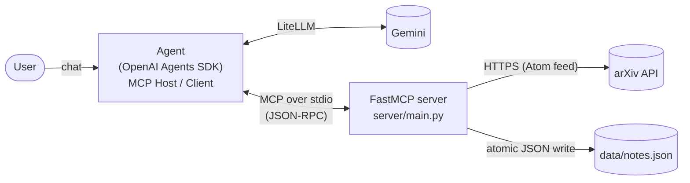

# Paper Tracker MCP Toolkit

EECE 503P/798S, C5 Agent Tools. A small **Model Context Protocol** toolkit for tracking arXiv papers:
a **FastMCP** server exposing exactly three single-purpose tools, and an agent built with the
**OpenAI Agents SDK** that acts as the MCP Host/Client and talks to Gemini through **LiteLLM**.

| Category          | Tool                 | What it does                                                        |
|-------------------|----------------------|---------------------------------------------------------------------|
| **Data**          | `search_arxiv`       | Looks up papers on arXiv. Read-only, changes nothing.               |
| **Action**        | `save_paper_note`    | Saves a note about one paper to local storage (`data/notes.json`).  |
| **Orchestration** | `build_reading_list` | Searches a topic, then saves a note for each of the top N papers.   |

Plus one read-only **resource**, `notes://papers`, which returns all saved notes as JSON.

## Architecture



One user request makes this round trip, and every hop is printed in the terminal:

```
You: Save the second one with the note: relevant for my 503 project
[agent → MCP] calling save_paper_note({"arxiv_id": "2610.30666", "title": "...", "note": "..."})   ← agent hook
[server] received save_paper_note arxiv_id='2610.30666' ...                                       ← server (stderr)
[server] save_paper_note -> saved 2610.30666
[MCP → agent] saved note for 2610.30666 (Your Token Is Gone: ...)                                  ← agent hook
Paper Tracker: Saved note for "Your Token Is Gone ..." (2610.30666).
```

The agent launches the server as a subprocess (`python -m server.main`) and speaks MCP over its
stdin/stdout. That's why the server logs only to **stderr**: anything printed to stdout would corrupt
the protocol stream.

## Repo layout

```
server/
  main.py           FastMCP app: 3 tools + 1 resource (thin wrappers only)
  arxiv_client.py   core: search_papers() -> list[Paper]
  storage.py        core: save_note(), list_notes(), atomic JSON storage
  models.py         Pydantic models: Paper, SavedNote, SkippedPaper, ReadingListResult
agent/run_agent.py  interactive chat loop, MCP connection, tool-call logging hooks, retries
scripts/
  demo_queries.py   runs the 5 screencast queries in order
  try_failures.py   calls each tool with bad input and prints the clean errors
tests/              offline pytest suite (in-memory MCP client, arXiv mocked with respx)
docs/               summary.md (written by Ahmad) and reflection_notes.md
data/               notes.json lives here (gitignored)
```

## Setup

1. **Install uv** (manages Python and dependencies):
   - Windows (PowerShell): `powershell -ExecutionPolicy ByPass -c "irm https://astral.sh/uv/install.ps1 | iex"`
   - macOS/Linux: `curl -LsSf https://astral.sh/uv/install.sh | sh`
2. **Install dependencies.** This also fetches Python 3.12, pinned in `.python-version`:
   ```bash
   uv sync
   ```
3. **Configure the model:**
   ```bash
   cp .env.example .env        # Windows: copy .env.example .env
   ```
   Get a free API key from [Google AI Studio](https://aistudio.google.com/apikey) and set
   `GEMINI_API_KEY` in `.env`. `MODEL` defaults to `gemini/gemini-flash-lite-latest` (see
   [Model choice](#model-choice-gemini-free-tier)).

Tested with Python 3.12, fastmcp 4.1.4, openai-agents 0.24.0, litellm 1.83.0 and mcp 2.3.0.

## Running

| What                                     | Command                                       | Needs key / network |
|------------------------------------------|-----------------------------------------------|---------------------|
| Interactive agent                        | `uv run python -m agent.run_agent`            | yes / yes           |
| Scripted demo (the 5 screencast queries) | `uv run python -m scripts.demo_queries`       | yes / yes           |
| Failure tour (each tool, bad input)      | `uv run python -m scripts.try_failures`       | no / no             |
| Test suite                               | `uv run pytest`                               | no / no             |
| MCP server alone (stdio)                 | `uv run python -m server.main`                | no / yes            |

- The **demo** runs these queries in order, pausing between them for rate limits:
  1. "Find 3 recent papers on LLM agent tool selection"
  2. "Save the second one with the note: relevant for my 503 project"
  3. "Build me a reading list of 3 papers on Model Context Protocol security"
  4. "Save paper abc123 with note test" (bad ID, clean error)
  5. "Save the second paper from the first search again" (duplicate, clean error)

  It then reads `notes://papers` over the same MCP connection. By default it uses a fresh temporary
  notes file so it can be re-run. Pass `--keep` to use `data/notes.json`, and `--pause 15` for longer
  pauses.
- **In the interactive agent**, type `exit` to quit. Conversation history is kept across turns, so
  follow-ups like "save the second one" work.
- **The tests** never touch the network or your notes. arXiv is mocked with `respx` and a sample Atom
  feed, storage goes to a per-test `tmp_path` (via `NOTES_PATH`), and tool calls go through the real
  MCP layer using FastMCP's in-memory `Client(mcp)`.

## Tool reference

**`search_arxiv(query, max_results=5, sort_by="relevance"|"recent") -> list[Paper]`**
Queries `export.arxiv.org/api/query` with a 10 s timeout. Every query term is required
(`all:LLM AND all:agent ...`), because arXiv reads a bare `all:LLM agent` as *LLM OR agent* and returns
mostly unrelated papers. A `Paper` has `arxiv_id` (version suffix stripped), `title`, `authors`,
`published` (YYYY-MM-DD), `summary` (whitespace collapsed, about 400 chars) and `pdf_url`. Zero
matches return `[]`, which is a valid answer, not an error.

**`save_paper_note(arxiv_id, title, note, tags=None) -> SavedNote`**
Appends to `data/notes.json` (override with `NOTES_PATH`). It writes a temp file and then calls
`os.replace`, so a crash can't leave a half-written file. It accepts new-style IDs (`2401.12345`,
`2401.12345v2`) and old-style IDs (`hep-th/9901001`), and stores them without the `vN` suffix. It
never fetches from arXiv: the title is an argument, which keeps the tool single-purpose.

**`build_reading_list(topic, n=3) -> ReadingListResult`**
Step 1 calls `search_papers(topic, n)`. Step 2 calls `save_note(...)` for each paper, with the note
`"Reading list: <topic>. <first sentence of abstract>"` and the tags `["reading-list", <topic-slug>]`.
It returns `topic`, `saved`, `skipped` (`arxiv_id` + `reason`) and a human-readable `message`.

**Resource `notes://papers`** (`application/json`) returns every saved note, or `[]` if nothing has
been saved yet.

## Design decisions

**Single-purpose tools.** Each tool does one thing and can be described without an "and":
`search_arxiv` only reads, `save_paper_note` only writes, and `build_reading_list` exists *because*
"search and then save" is an "and". Small tools are easier for the model to pick correctly, easier
to test, and fail in predictable ways. For example, `save_paper_note` deliberately takes the title
as input instead of looking it up, so it has no network dependency and no hidden second job.

**The orchestration tool reuses core functions instead of calling tools over MCP.** The logic lives
in plain Python (`arxiv_client.search_papers`, `storage.save_note`), and the MCP tools in `main.py`
are thin wrappers around it. `build_reading_list` calls the same two functions directly. Going
server → client → server over MCP would add latency and failure points, and it would make the server
depend on its own transport. Sharing the core functions keeps one source of truth for validation and
behavior, and lets the orchestration tool handle partial failure per paper.

**Failure handling.** Predictable failures are raised as plain exceptions in the core (`ValueError`,
`ArxivUnavailableError`, `DuplicateNoteError`, `StorageError`). The tool layer converts them into a
FastMCP `ToolError` with a message written for the user, which the agent can explain.
`mask_error_details=True` means an unexpected bug yields a generic error, never a raw traceback.

| Situation                                | Behavior                                                          |
|------------------------------------------|-------------------------------------------------------------------|
| Empty query / topic, out-of-range number | `ToolError` naming the allowed range; arXiv is not called         |
| arXiv timeout, connection error, non-200 | `ToolError("arXiv is unavailable right now (…). Try again …")`    |
| No search results                        | Empty list / empty reading list with a message (not an error)     |
| Bad arXiv ID                             | `ToolError` showing the expected formats                          |
| Paper already saved                      | `ToolError("Paper <id> is already saved.")`; never overwritten    |
| Duplicate inside a reading list          | Goes to `skipped` with the reason; the other papers are still saved |
| Search fails inside a reading list       | `ToolError("Step 1 (search arXiv) failed: … Nothing was saved.")` |
| Gemini rate limit (429) / overload (503) | Retried with backoff, then a friendly message in the chat         |

Numeric ranges (1–20, 1–10) are validated in code rather than as JSON-schema `ge`/`le` constraints.
That way the agent gets a readable `ToolError` that names the range, instead of a raw Pydantic
validation error. The range is still stated in each parameter's description.

**Data as a resource.** Listing saved notes is a pure read with no parameters, so it's exposed as the
`notes://papers` resource rather than as a fourth tool.

## Model choice (Gemini free tier)

- The default model is `gemini/gemini-flash-lite-latest`. During development,
  `gemini-flash-latest` was frequently overloaded (HTTP 503) and its free tier allows only about
  **20 requests per day**. Failed requests appear to count toward that cap too. One run of the demo
  uses about 10–12 requests. To use the stronger model, set `MODEL=gemini/gemini-flash-latest` in
  `.env`.
- Reasoning effort is set to **low**. With the lite model's default (minimal) thinking, testing
  showed occasional empty replies and wrong tool picks. Low effort fixed both.
- Retries use the Agents SDK's `ModelRetrySettings`: per-minute 429s and transient errors are retried
  with exponential backoff (honoring retry-after hints). A **per-day** quota 429 is never retried,
  since that would only burn quota, and a 503 is retried once. If a turn comes back empty without
  having run any tool, it is retried once.
- OpenAI tracing is disabled (`set_tracing_disabled(True)`) because there is no OpenAI key. Tool
  calls are logged locally by `RunHooks` instead.

## Known limits

- **Free-tier rate limits.** Gemini allows about 15 requests per minute plus a daily cap that varies
  by model. The agent retries and then explains. The demo script pauses 8 s between queries.
- **arXiv etiquette.** arXiv asks API users to keep the request rate low (about one request every
  3 s) and may answer HTTP 429 or time out under load. This project makes one request per
  search, sends a descriptive User-Agent, and does no automatic retries against arXiv.
- **Local JSON storage.** Single-user, with no locking across concurrent processes, and
  the whole file is rewritten on each save. Fine for a personal tracker, not for a shared service.
- **No delete or edit.** By design there are exactly three tools, so notes can't be removed through
  the agent. Edit `data/notes.json` by hand if needed.
- **LLM variability.** Gemini, especially the lite model, can still misroute an ambiguous request.
  The tools validate everything server-side, so a bad call yields a clean error rather than bad data.
- Abstracts are cut to about 400 characters, and the agent sees only what the tools return. It can't
  read full PDFs.

## Docs

- [`docs/summary.md`](docs/summary.md): Part 1 summary of the MCP article and an existing MCP
  server (written by Ahmad).
- [`docs/reflection_notes.md`](docs/reflection_notes.md): working notes for the reflection.
